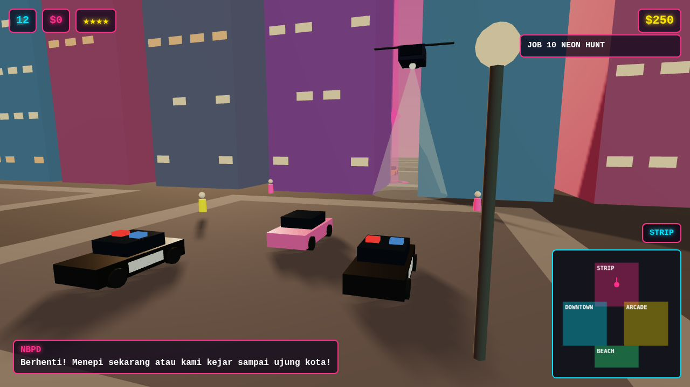
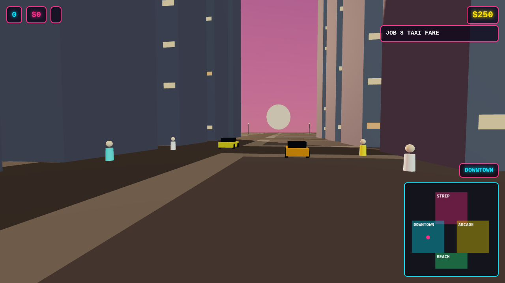
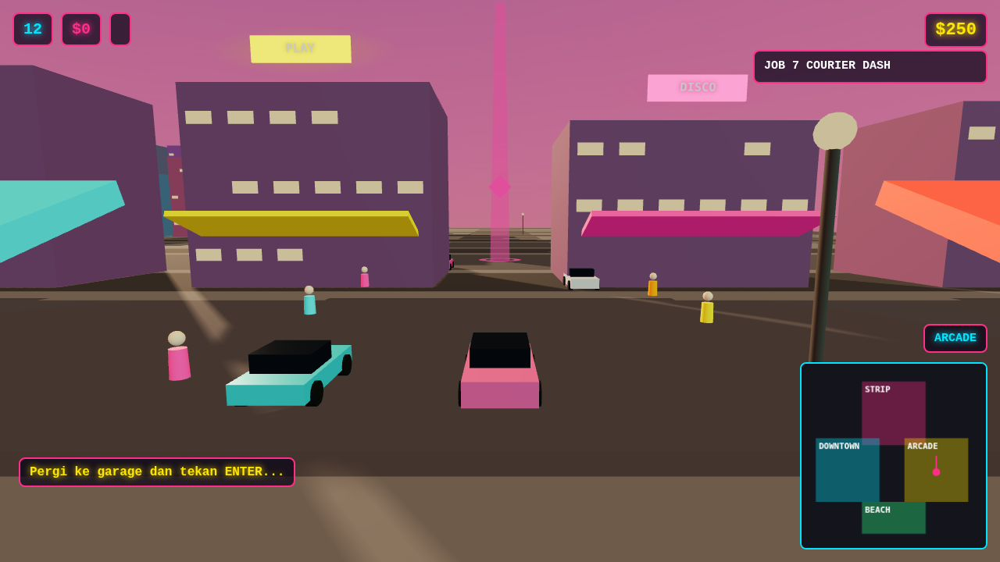
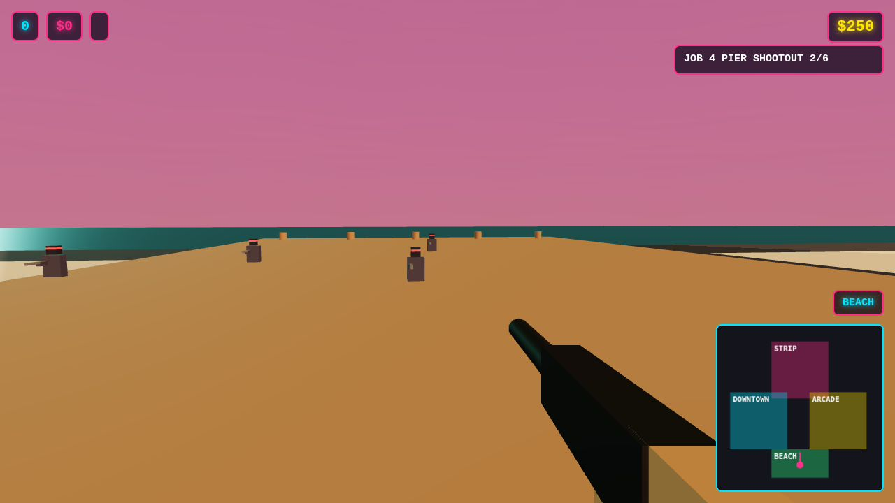

Dibuat untuk bounty [gta6-01 di make.fun](https://make.fun/bounty/gta6-01) — game open-world 3D, hadiah $1.666.

# NEON BAY: SUNSET RUN

Game open-world 3D bergaya GTA di kota fiksi Neon Bay saat golden hour. Kamu adalah kurir/pengemudi: mengantar fare, kabur dari polisi, menyelesaikan 10 JOB, mengoleksi uang, dan memakai garasi untuk ganti kendaraan.

Jelajahi empat distrik — STRIP, DOWNTOWN, ARCADE, dan BEACH — dengan sedan pink, bike, dan sport cyan, sambil dikejar cruiser NBPD dan helikopter di bawah langit senja.

## Cara Main

- **WASD / Arrow keys** — mengemudi / jalan kaki
- **ENTER** — mulai game, konfirmasi, masuk garasi
- **E** — interaksi
- **R** — reload senjata
- **Space** — rem / aksi
- **M** — mute radio

Buka `game/index.html` di browser (atau jalankan `node serve.ts` lalu buka `http://localhost:8080/game/index.html`).

## Screenshot

- 
- 
- 
- 

## Lisensi

MIT
